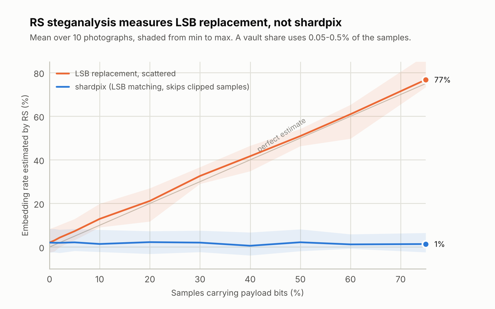
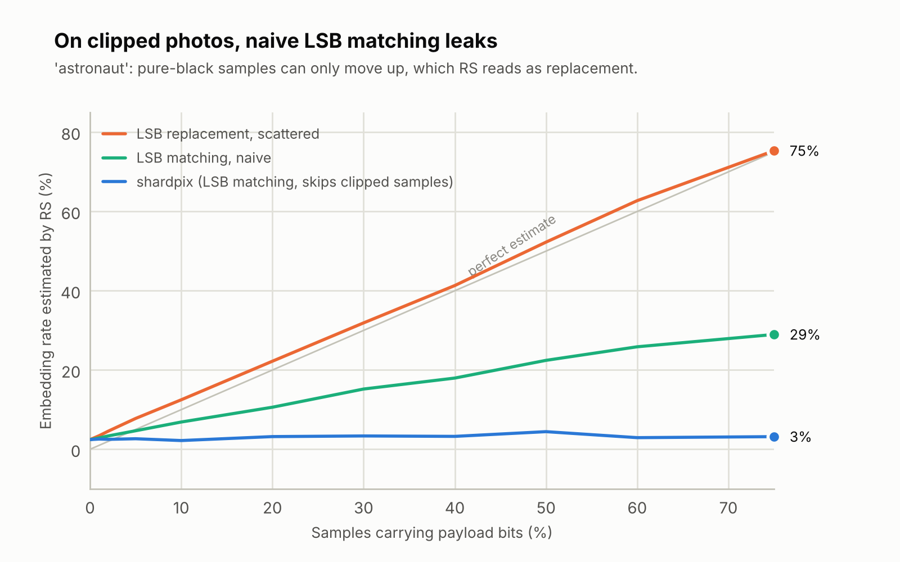
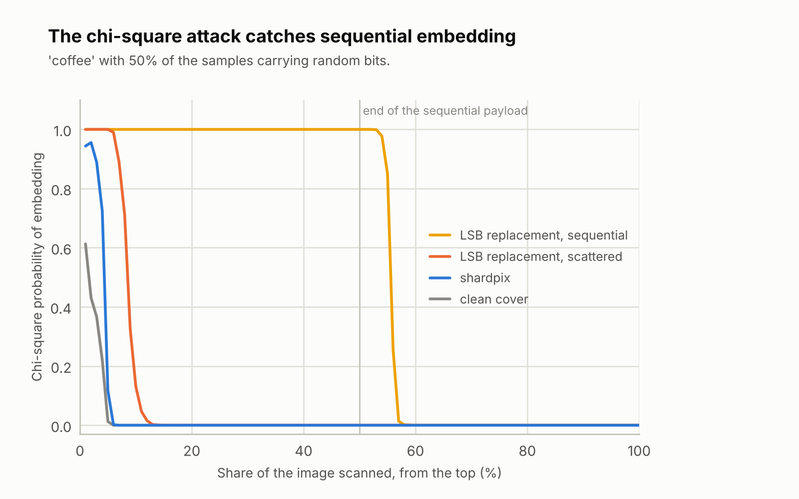
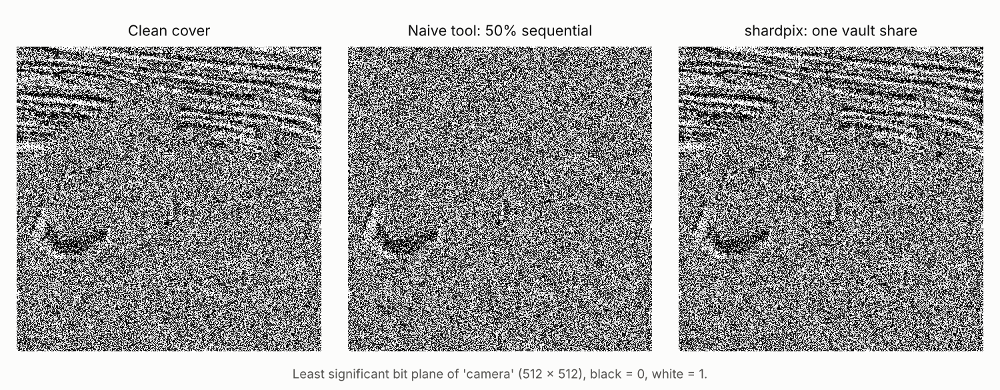
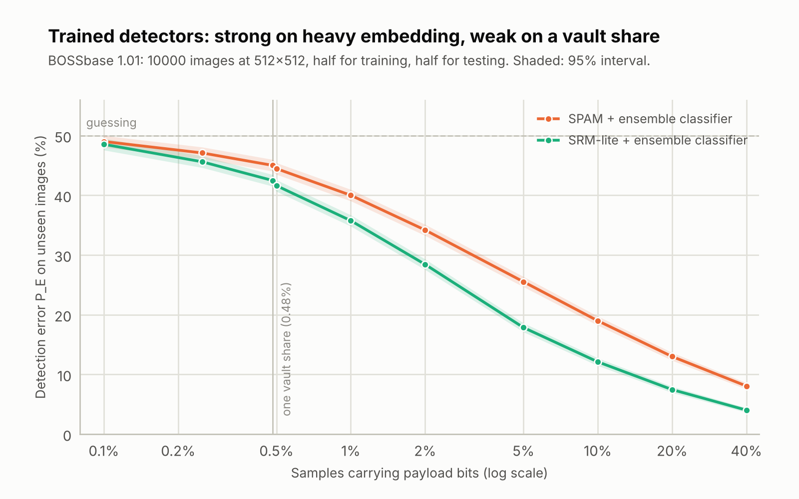
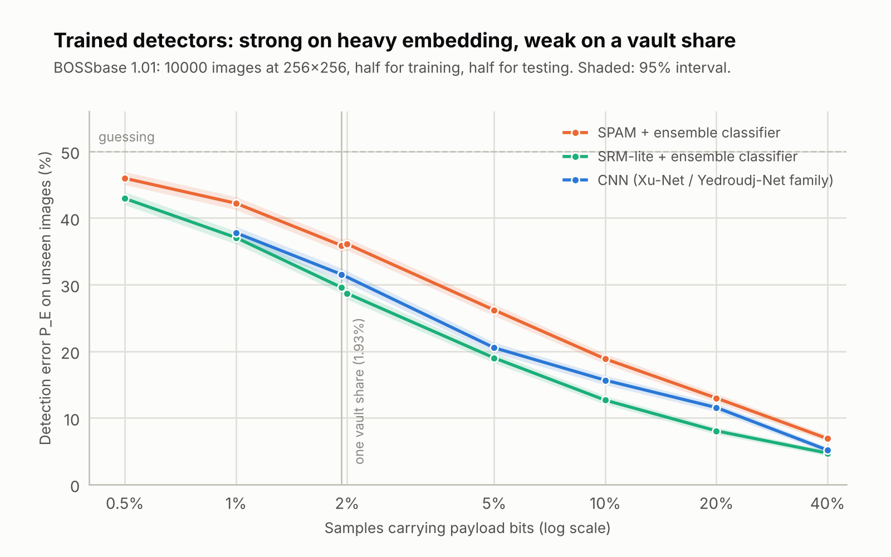
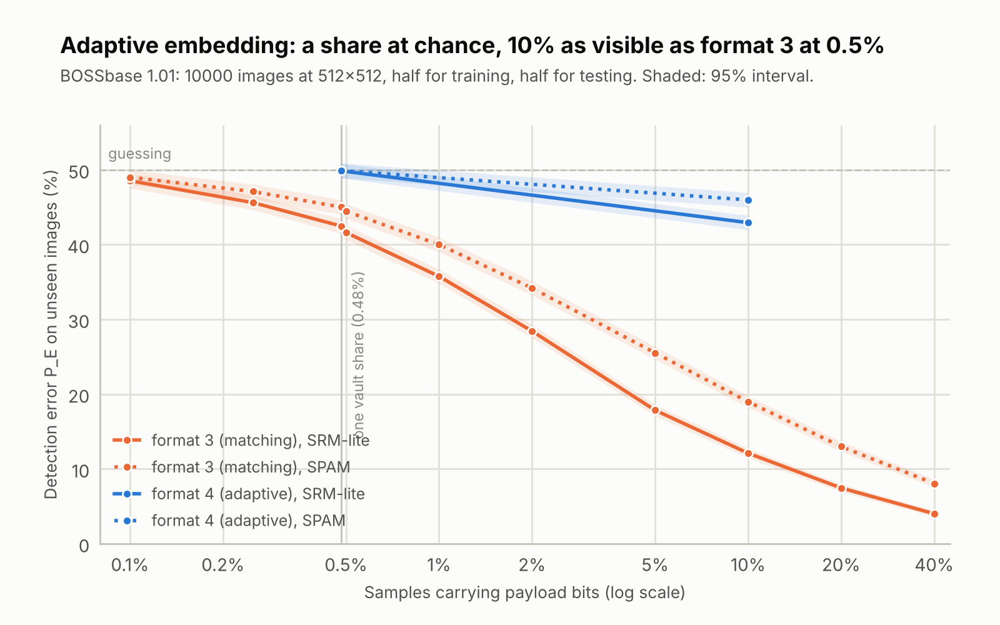
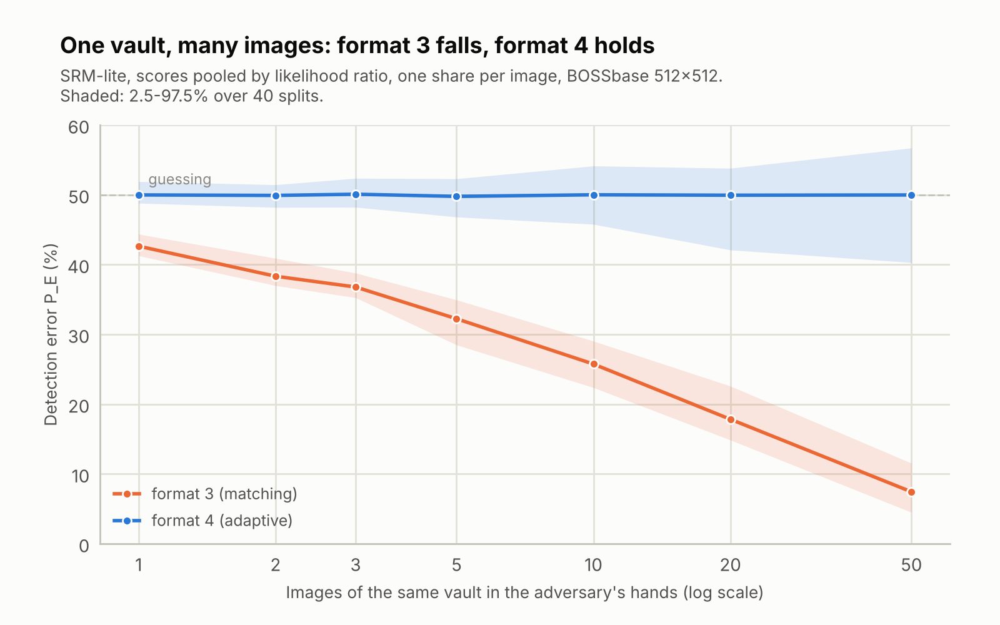
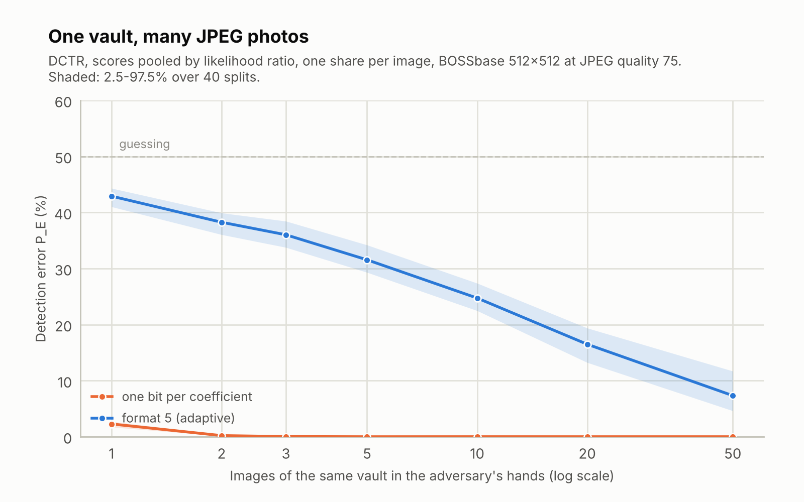
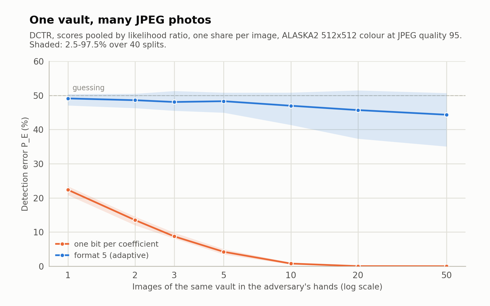

# 5. Security analysis

| | |
| --- | --- |
| Document | SDD-05 — Security analysis |
| System | shardpix 3.0.0 |
| Status | Approved |
| Last revised | 2026-10-18 |

## 5.1 Purpose and scope

This document states what shardpix protects, against whom, on which
arguments, and where it stops. It also reports the steganalysis measurements
that back the claims about detectability.

shardpix is a portfolio and learning project. Its cryptography comes from
audited libraries (ADR-02), its own code is tested against independent
references, and it has been through the two reviews documented in
[06-security-review.md](06-security-review.md), neither of them
independent: **the system as a whole has not been audited by an
independent third party**. For secrets whose loss would really hurt, prefer
established tools
— for example [age](https://age-encryption.org) for file encryption and
[SLIP-0039](https://github.com/satoshilabs/slips/blob/master/slip-0039.md)
implementations for secret sharing — and treat shardpix as a well-documented
way to understand how such tools are built.

## 5.2 Threat model

### 5.2.1 Assets

| Asset | Description |
| --- | --- |
| A-1 File contents | The sealed file. |
| A-2 Key | The 256-bit key that encrypts it. |
| A-3 Existence | The fact that a given image carries hidden data at all. |
| A-4 Availability | The ability of k honest holders to recover the file. |

### 5.2.2 Adversaries

| Id | Adversary | Capabilities |
| --- | --- | --- |
| ADV-1 | Curious holder or coalition | Holds up to k − 1 images, may know the passphrase, may hold the vault file. |
| ADV-2 | Passive finder | Has some images (a stolen phone, a shared album), not the passphrase. |
| ADV-3 | Steganalyst | Wants to tell stego images from ordinary photos; has the tool and its source. |
| ADV-4 | Active forger | Can modify images, fabricate shares (knows the public group id) and modify the vault file. |
| ADV-5 | Collecting steganalyst | Like ADV-3, but holds several images of the same vault (several holders' phones, a shared album) and combines the evidence. |

### 5.2.3 Assumptions

1. The machine running shardpix is not compromised while sealing or unsealing.
2. The original covers are not available to the adversary (see §5.6).
3. The passphrase, when used, is not guessable within the scrypt budget.
4. Images travel as files; nobody re-compresses or resizes them on the way.
5. The adversary knows everything about the design (Kerckhoffs's principle):
   every argument below assumes the source code is public, because it is.

## 5.3 Security properties

| Id | Property | Against | Argument | Verified by |
| --- | --- | --- | --- | --- |
| SP-01 | The file is confidential without k shares | ADV-1, ADV-2 | AES-256-GCM under a uniformly random key that exists only as Shamir shares (and briefly in memory). | `test_vault.py::TestFailures` |
| SP-02 | The file and its metadata are authentic | ADV-4 | GCM tag over the ciphertext; the header (group id, k, n, nonce) is the associated data; the file name is inside the ciphertext. | `test_tampered_vault_file`, `test_tampered_header_is_detected` |
| SP-03 | k − 1 shares reveal nothing about the key | ADV-1 | Each byte of key ‖ MAC key has its own random polynomial of degree k − 1, so any k − 1 values are uniform whatever the key. The MACs depend only on the MAC key, which is shared the same way, so they add nothing — even for a low-entropy secret (ADR-08). Only the secret's length leaks. | `TestSecrecy` (exhaustive over all coefficients), `test_mac_is_not_keyed_with_the_secret` |
| SP-04 | Damaged or altered shares are detected and identified | ADV-4 | The checksum catches accidental damage without a key; once k good shares reconstruct the MAC key, every other share is checked and reported. | `TestAuthentication`, `TestRobustSearch` |
| SP-05 | An image reveals neither its payload nor which samples hold it | ADV-2, ADV-3 | Payload sealed with AES-256-GCM; positions from a ChaCha20 walk keyed by scrypt(passphrase, per-image salt); length masked. Without the passphrase the written bits are indistinguishable from random (formats 6 and 7; in formats 3-5 the public cost byte is a constant, 06 SR-07). | `TestAuthentication`, `TestKeyDerivation` |
| SP-06 | A fabricated set of shares is never accepted as the vault key | ADV-4 | Clusters are disjoint; each candidate key is tested against the vault's GCM tag, which a forger cannot satisfy without the real key. | `TestForgedSets` |
| SP-07 | Passphrase guessing is expensive and per image | ADV-2 | scrypt N = 2^17, r = 8 (≈ 128 MiB, ≈ 0.4 s per guess, OWASP's first recommendation), salted per image, so no table can be precomputed for an image size and no guess carries over to another image. | `test_production_scrypt_cost`, `test_same_passphrase_scatters_differently_in_every_image` |
| SP-08 | One error message for every extraction failure | ADV-3, ADV-4 | Wrong passphrase, clean image and modified image all raise the same `PayloadNotFoundError`, so the tool is no oracle for "is there something here?". | `TestAuthentication` |
| SP-09 | Neither classical nor trained steganalysis (SPAM, SRM-lite) detects a vault share in format 6 | ADV-3, ADV-5 | Adaptive ±1 embedding with syndrome-trellis codes [31] and HiLL costs [30] (ADR-12), no forced moves at 0/255 (ADR-06), and a fixed payload of 1,256 bits (1,264 in formats 3-5). Measured on format 4, which differs only by the public cost byte (format-4 images themselves are recognisable without a key, 06 SR-07): at chance on BOSSbase 512x512 (§5.5.6), also when up to fifty images of one vault are pooled (§5.5.7); format 3 was weakly detectable, and strongly so once pooled (§5.5.5, §5.5.7). | Benchmarks (§5.5.1–5.5.7) |
| SP-10 | Restoring a file cannot escape the output directory or abuse the terminal | ADV-4 | `safe_filename` keeps the base name, strips control and format characters and replaces reserved names. | `TestRestoredNames`, `TestSafeFilename` |
| SP-11 | No input is ever overwritten | User error | Case-folded path identity checks in the CLI and in `seal`. | `TestOutputCollisions`, `test_combine_never_overwrites_its_input` |
| SP-12 | Trained steganalysis (DCTR, GFR, SRNet) does not detect one vault share in a JPEG cover of quality 90-95 in format 7 | ADV-3, ADV-5 | The same embedding in the DCT coefficients with UERD costs [32] (ADR-13). Measured on format 5, which differs only by the public cost byte (format-5 images themselves are recognisable without a key, 06 SR-07): at chance on one image at quality 90-95 (§5.5.8, §5.5.9), and with up to fifty images pooled except for a weak DCTR trend at quality 95 over dozens of images; at quality 75 a weak per-image signal becomes detectable when pooled, and the CLI warns below quality 90. | Benchmarks (§5.5.8–5.5.9) |

What shardpix deliberately does **not** claim: that a share is invisible to
*every* trained detector — format 4 is at chance against SPAM and SRM-lite
(§5.5.6), but stronger detectors were not run — that format 3 shares are
invisible in small covers (they are not, §5.5.5), that format 7 is invisible
in heavily compressed JPEGs (at quality 75 it is detectable once pooled,
about 7-16% detection error with fifty images, §5.5.8–5.5.9), that it is
invisible to an adversary pooling dozens of images at quality 95 (DCTR shows
a weak trend there, §5.5.9), or that the vault file itself is inconspicuous
— it is recognisable ciphertext.

## 5.4 Cryptographic parameters

| Purpose | Primitive | Parameters | Source |
| --- | --- | --- | --- |
| File encryption | AES-256-GCM | 256-bit random key, 96-bit random nonce, 35-byte AAD | `cryptography` |
| Stego payload encryption | AES-256-GCM | 256-bit derived key, 96-bit random nonce, AAD = domain ‖ version ‖ length | `cryptography` |
| Passphrase hardening | scrypt [9] | N = 2^17, r = 8, p = 1, 128-bit salt per image; N fixed by the format version (6, 7); formats 3-5 store it in the image, 2^10 to 2^18 accepted when reading | `hashlib` |
| Key separation | HKDF-SHA256 | Labels `order`, `aead`, `length` | `cryptography` |
| Sample positions | ChaCha20 keystream | 256-bit key, rejection-sampled modular reduction | `cryptography` |
| Share authentication | HMAC-SHA256 | 256-bit shared MAC key, tag truncated to 128 bits | `hmac` |
| Share checksum | SHA-256 | Truncated to 32 bits (accidental damage only) | `hashlib` |
| Secret sharing | Shamir over GF(2^8) | Polynomial 0x11B, generator 0x03, k ≤ n ≤ 255 | this project |
| Randomness | `os.urandom` | — | OS CSPRNG |

Nonce reuse is not a concern: every AES-GCM key is used to encrypt exactly
once (the vault key is fresh per vault; the stego key is fresh per image
because the salt is), and the ChaCha20 keys are only ever used to generate a
single keystream.

## 5.5 Steganalysis results

The benchmark embeds random bits — what an encrypted payload looks like — in
ten public-domain photographs from scikit-image (six RGB, four greyscale) at
eleven rates from 0 to 75% of the samples, with four strategies, and runs the
two classical attacks. Run it with `python -m shardpix.analysis.benchmark`;
the raw numbers are in [data/benchmark.json](data/benchmark.json). §5.5.5
adds trained detectors on a standard dataset of 10,000 photographs.

**Formats measured.** Every measurement in this section was made on formats
3, 4 and 5. Formats 6 and 7 (01 §1.5.1) embed exactly like 4 and 5 but write
128 public bits instead of 136. Their key domains differ, so the keyed
positions differ, but they make the same number and kind of changes, chosen
by the same costs, minus at most a handful; the detection errors below apply
to them. What these
detectors do not measure is a reader who decodes the public block without
a key: in formats 3 to 5 that reader found the cost byte, the same in every
image, and recognised a shardpix image whatever the detectors said (06
§6.13, SR-07). Formats 6 and 7 remove it.

### 5.5.1 RS analysis

<picture>
  <source media="(prefers-color-scheme: dark)" srcset="../assets/rs-estimate-dark.png">
  
</picture>

Mean RS estimate (Fridrich, Goljan and Du [3]) over the ten photographs:

| Strategy | 0% | 5% | 10% | 20% | 50% | 75% |
| --- | ---: | ---: | ---: | ---: | ---: | ---: |
| LSB replacement, scattered | +2.0% | +7.3% | +12.9% | +21.2% | +50.9% | +76.8% |
| LSB matching, naive | +2.0% | +2.6% | +2.4% | +1.3% | +2.7% | +3.6% |
| shardpix | +2.0% | +2.2% | +1.4% | +2.3% | +2.2% | +1.4% |

RS measures LSB replacement almost exactly, and sees neither variant of LSB
matching on average. The average hides one case, which is what motivated
ADR-06:

<picture>
  <source media="(prefers-color-scheme: dark)" srcset="../assets/rs-clipped-dark.png">
  
</picture>

RS estimate per photograph with 50% of the samples carrying data:

| Cover | Clean | LSB replacement | LSB matching, naive | shardpix |
| --- | ---: | ---: | ---: | ---: |
| astronaut | +2.4% | +52.3% | +22.4% | +4.5% |
| chelsea | +0.0% | +49.8% | -0.4% | -1.0% |
| coffee | +2.1% | +52.3% | +1.7% | +3.3% |
| rocket | +0.9% | +51.2% | +0.8% | +0.7% |
| hubble_deep_field | +8.3% | +54.2% | +2.8% | +5.9% |
| immunohistochemistry | -2.5% | +47.9% | -2.2% | +3.2% |
| camera | +1.2% | +52.4% | +1.0% | -0.0% |
| brick | +0.3% | +51.9% | -1.0% | -1.0% |
| grass | +0.7% | +46.3% | -6.0% | +8.2% |
| gravel | +6.9% | +51.1% | +7.8% | -1.9% |

`astronaut` has 11% of its samples at pure black. Under naive LSB matching
those can only move up, from 0 to 1 — exactly the move LSB replacement makes
— and RS reads 22%. Skipping samples outside 2–253 brings it to 4.5%. On the
fine greyscale textures (`grass`, `gravel`) RS scatters by several points
between runs whatever is embedded: a single channel gives it fewer groups to
average over.

### 5.5.2 The operating point: one vault share

The figures above go up to 75% to show the shape of each curve. A vault puts
158 bytes into each image in formats 3 to 5 (157 in formats 6 and 7). The
table was measured on format 4 (`benchmark.py` pins `version=4`):

| Cover | Size | Share embedding rate | RS, clean | RS, with share | Change |
| --- | --- | ---: | ---: | ---: | ---: |
| astronaut | 512x512 RGB | 0.161% | +2.45% | +2.47% | +0.02% |
| chelsea | 451x300 RGB | 0.311% | +0.05% | +0.01% | -0.04% |
| coffee | 600x400 RGB | 0.176% | +2.12% | +2.13% | +0.01% |
| rocket | 640x427 RGB | 0.154% | +0.92% | +0.91% | -0.01% |
| hubble_deep_field | 1000x872 RGB | 0.048% | +8.31% | +8.30% | -0.02% |
| immunohistochemistry | 512x512 RGB | 0.161% | -2.46% | -2.35% | +0.11% |
| camera | 512x512 grey | 0.482% | +1.24% | +1.35% | +0.11% |
| brick | 512x512 grey | 0.482% | +0.29% | +0.18% | -0.11% |
| grass | 512x512 grey | 0.482% | +0.68% | -0.02% | -0.70% |
| gravel | 512x512 grey | 0.482% | +6.89% | +7.01% | +0.12% |

The median change is 0.07 points, against clean photographs that already
range from −2.5% to +8.3%. The largest change, 0.7 points, is on a greyscale
texture, inside the scatter described above. At this rate, RS cannot tell a
sealed image from the photo it came from.

### 5.5.3 Chi-square attack

<picture>
  <source media="(prefers-color-scheme: dark)" srcset="../assets/chi-square-dark.png">
  
</picture>

The chi-square attack (Westfeld and Pfitzmann [2]) is decisive against what naive tools do — write the
payload from the first pixel with LSB replacement — and reads the payload
length off the curve (it ends a little after the true 50%, because the test
statistic is cumulative). Scattered replacement at the same rate keeps it
high only over the first few percent, and shardpix behaves like the clean
cover.

The attack is also prone to false positives: on four of the ten clean
photographs (`chelsea`, `immunohistochemistry`, `grass`, `gravel`), whose
histograms are naturally smooth, it reports a signature over 46% to 100% of
the image. `analyze` reports it as evidence, not as a verdict.

### 5.5.4 The visual attack



The least significant bit plane of a photograph is not pure noise: smooth
regions leave structure in it, as the sky bands at the top of `camera` show.
A naive tool replacing the first half of the image erases that structure, and
the boundary is visible to the eye. A vault share changes a few hundred
samples out of 262,144 and is invisible.

### 5.5.5 Trained detectors

Chi-square and RS need no training. Modern steganalysis does: a detector
learns the difference between covers and stego images from thousands of
examples. This section runs three such detectors against shardpix:

| Detector | Features | Classifier |
| --- | --- | --- |
| SPAM | 686 Markov transition probabilities of pixel differences, designed against LSB matching (Pevný, Bas and Fridrich [12]) | Ensemble of Fisher linear discriminants on random subspaces (Kodovský, Fridrich and Holub [13]) |
| SRM-lite | 3,125 co-occurrences of five rich-model residuals (Fridrich and Kodovský [7]); the full SRM has 34,671 | The same ensemble |
| CNN | Learnt, after a fixed bank of 14 SRM high-pass filters and a truncation unit | Five convolutional blocks of the Xu-Net [15] / Yedroudj-Net [16] family, trained with curriculum from high to low rates |

**Data.** BOSSbase 1.01 [14], the reference set for spatial-domain steganalysis:
10,000 greyscale 512x512 photographs converted from RAW, never
JPEG-compressed. Every cover is embedded with shardpix's own strategy
(LSB matching on samples 2–253, keyed positions, random bits) at each rate.
Half of the images train the detector, the other half test it; a cover and
its stego image are always on the same side.

**The attacker is given every advantage.** The detector is trained at the
exact rate it is tested on and on images from the same source as the test
images. In the field a steganalyst knows neither the rate nor the camera and
processing that produced the covers, and *cover-source mismatch* - training
on one kind of image and testing on another - is known to cost trained
detectors accuracy, often substantially. The numbers below are
therefore an upper bound on what these detectors achieve, not an estimate of
what they would achieve on a real holder's photo.

**Metric.** P_E = (false alarms + missed detections) / 2 on the 5,000 test
pairs, at the detector's own decision threshold: 50% is guessing, 0% is
never wrong. The interval is the 95% binomial interval (about ±1 point).

<picture>
  <source media="(prefers-color-scheme: dark)" srcset="../assets/ml-detection-512-dark.png">
  
</picture>

BOSSbase at its native 512x512 (raw numbers in
[data/ml_benchmark_512.json](data/ml_benchmark_512.json)):

| Samples carrying bits | Bits | M/√N | SPAM | SRM-lite |
| ---: | ---: | ---: | ---: | ---: |
| 40% | 104,858 | 205 | 8.1% | 4.0% |
| 10% | 26,214 | 51 | 19.0% | 12.1% |
| 2% | 5,243 | 10 | 34.2% | 28.4% |
| 1% | 2,621 | 5.1 | 40.0% | 35.8% |
| **0.48% (one share)** | **1,264** | **2.5** | **45.0%** [44.0, 46.0] | **42.5%** [41.5, 43.5] |
| 0.25% | 655 | 1.3 | 47.1% [46.1, 48.1] | 45.6% [44.6, 46.6] |
| 0.1% | 262 | 0.5 | 49.0% [48.0, 50.0] | 48.5% [47.6, 49.5] |

Resized to 256x256, the size most deep-learning steganalysis is evaluated
at, a share is 1.93% of the samples (raw numbers in
[data/ml_benchmark_256.json](data/ml_benchmark_256.json)):

<picture>
  <source media="(prefers-color-scheme: dark)" srcset="../assets/ml-detection-256-dark.png">
  
</picture>

| Samples carrying bits | Bits | M/√N | SPAM | SRM-lite | CNN |
| ---: | ---: | ---: | ---: | ---: | ---: |
| 40% | 26,214 | 102 | 6.9% | 4.7% | 5.2% |
| 20% | 13,107 | 51 | 13.0% | 8.1% | 11.6% |
| 10% | 6,554 | 26 | 18.9% | 12.7% | 15.7% |
| 5% | 3,277 | 13 | 26.2% | 19.0% | 20.5% |
| 2% | 1,311 | 5.1 | 36.1% | 28.7% | — |
| **1.93% (one share)** | **1,264** | **4.9** | **35.9%** [34.9, 36.8] | **29.6%** [28.7, 30.5] | **31.6%** [30.6, 32.5] |
| 1% | 655 | 2.6 | 42.2% | 37.1% | 37.8% |
| 0.5% | 328 | 1.3 | 46.0% | 42.9% | — |

The CNN was trained once, from 40% down to 1%, fine-tuning at each rate
from the previous one (20 epochs at 40%, then 5 per rate, on 128x128
windows; about two hours on four CPU cores). It is not run at 512x512, where
training and testing would take several times longer on a CPU.

What this shows:

1. **The detectors work.** At 40% embedding the rich model is wrong 4% of
   the time.
2. **One share in a 512x512 greyscale photo is detectable, weakly.** P_E is
   42.5% (AUC 0.61) for SRM-lite: well above chance with these sample sizes,
   but a detector that is wrong on 42 of every 100 decisions. At a realistic
   base rate - few of the photos a steganalyst inspects carry anything -
   almost every alarm it raises would be false. The expectation stated
   before this measurement, that trained detectors would not see a share at
   all, was wrong for covers this small.
3. **Smaller covers are worse.** At 256x256 the same 158 bytes (format 3) are 1.93% of
   the samples and SRM-lite drops to 29.6%. The CNN reaches 31.6%: a
   network of this size, trained on a CPU, matches the rich model rather
   than beating it, so deep learning does not change the picture at this
   scale.
4. **What matters is the payload against the square root of the cover.**
   The *square-root law* of steganographic capacity (Ker et al. [17]) says a fixed
   payload of M bits in a cover of N samples becomes harder to detect as
   M/√N decreases, not merely as M/N does. The share is fixed at 1,264 bits (1,256 in formats 6 and 7),
   so the cover size alone decides. At M/√N ≈ 0.5 SPAM is at the edge of
   chance (49.0%, interval up to 50.0%) and SRM-lite is 1.5 points from it (48.5%, AUC 0.52). The two image sizes agree with the law only
   roughly (at M/√N = 1.3, SRM-lite reads 45.6% at 512 and 42.9% at 256),
   because resizing changes the noise the detectors rely on.

What it means for a real cover: a share in a 512x512 greyscale image has
M/√N ≈ 2.5; in a 1-megapixel colour photo (3 million samples) ≈ 0.7; in a
2-megapixel colour photo ≈ 0.5, the lowest point measured; in a
12-megapixel phone photo ≈ 0.2, more than twice below it. **Use colour photos of at least
2 megapixels** — the advice was derived for format 3; format 6 (measured as format 4) is
already at chance at 512x512 (§5.5.6), and more samples remain the safer choice. That threshold is an extrapolation along the square-root law
from greyscale 512x512 images, not a measurement on large photos, which
BOSSbase does not contain.

Reproduce (about one hour for the feature-based detectors at each size on
four CPU cores; the CNN about two more):

```bash
pip install -e ".[bench,ml]"
python -m shardpix.analysis.ml_benchmark BOSSbase_1.01/ --size 512 --detectors spam,srm_lite
python -m shardpix.analysis.ml_benchmark BOSSbase_1.01/ --size 512 --detectors spam,srm_lite --rates 0.0025,0.001
python -m shardpix.analysis.ml_benchmark BOSSbase_1.01/ --size 256 --rates 0.4,0.2,0.1,0.05,0.02,0.01,0.005 --detectors spam,srm_lite
python -m shardpix.analysis.ml_benchmark BOSSbase_1.01/ --size 256 --rates 0.4,0.2,0.1,0.05,0.01 --detectors cnn --fine-epochs 5 --checkpoint cnn-256
```

### 5.5.6 Adaptive embedding (format 4)

§5.5.5 found that format 3 is weakly visible to trained detectors in small
covers. Format 4 (01 ADR-12) writes the same payload as a syndrome-trellis
code [31] whose changes follow HiLL costs [30]: about a third as many changes (208
against 633 per share in BOSSbase 512x512, 01 ADR-12), all in texture. The
same experiment, the same 10,000 BOSSbase images, the same split and the
same detectors were run against it; the stego images are produced by
`stego.embed` pinned to format 4 (`ml_benchmark --strategy adaptive`).
Format 6, which the tool writes now, differs only by the public cost byte
(§5.5, Formats measured).

<picture>
  <source media="(prefers-color-scheme: dark)" srcset="../assets/ml-format-comparison-512-dark.png">
  
</picture>

Raw numbers in [data/ml_benchmark_512_adaptive.json](data/ml_benchmark_512_adaptive.json).

| Samples carrying bits | Format 3, SPAM | Format 3, SRM-lite | **Format 4, SPAM** | **Format 4, SRM-lite** |
| ---: | ---: | ---: | ---: | ---: |
| **0.48% (one share)** | 45.0% | 42.5% | **49.9%** [48.9, 50.9], AUC 0.50 | **49.9%** [48.9, 50.8], AUC 0.50 |
| 10% | 19.0% | 12.1% | **46.0%** [45.0, 47.0], AUC 0.57 | **42.9%** [42.0, 43.9], AUC 0.61 |

What this shows:

1. **One share in format 4 is at chance.** Both detectors, trained at the
   exact rate on images from the same source as the test images, are wrong
   49.9% of the time; the 95% intervals contain 50% and the AUC is 0.50.
   Format 3 at the same rate gave 42.5%.
2. **The measurement is not blind.** At 10% the same detectors see format 4
   (SRM-lite 42.9%, interval well below 50%), so the experiment can detect
   it when there is something to detect. A null result with no positive
   control would have proved nothing.
3. **The gain is large.** Format 4 at 10% of the samples is about as
   visible as format 3 at one share (42.9% against 42.5%), with twenty
   times the payload. In square-root-law terms the same cover now carries
   a far larger payload at the same risk; for a fixed share it moves the
   operating point well inside the region where these detectors fail.
4. **What it does not show.** Stronger detectors (the full SRM with its
   min-max residuals, SRNet trained on a GPU) are designed for adaptive
   embedding and could still find something at one share. The intermediate
   rates (5%, 2%, 1%) were not measured in full: a first run at 1%,
   interrupted before it was saved, gave 49.7% (SPAM) and 50.3% (SRM-lite),
   and is not part of the data file.

Reproduce (about 1.5 hours per rate on four CPU cores, the
syndrome-trellis coder being pure numpy):

```bash
python -m shardpix.analysis.ml_benchmark BOSSbase_1.01/ --size 512 --strategy adaptive --detectors spam,srm_lite --rates 0.00482177734375
python -m shardpix.analysis.ml_benchmark BOSSbase_1.01/ --size 512 --strategy adaptive --detectors spam,srm_lite --rates 0.1,0.05,0.02,0.01
```


### 5.5.7 Several images of one vault (pooled steganalysis)

Steganalysis is usually evaluated one image at a time, as in §5.5.5–5.5.6.
A vault is not one image: its n shares sit in n photographs, and ADV-5 can
hold several of them and combine the evidence (*pooled steganalysis*, Ker
[18]; §5.7 places this measurement in the related work).
This is specific to threshold schemes, and the per-image results above do
not answer it.

**Method** (`python -m shardpix.analysis.pooled`, raw numbers in
[data/pooled_512.json](data/pooled_512.json)). The detectors of §5.5.5–5.5.6
score each of the 5,000 test images and its stego version. The adversary
receives g different photographs and must decide whether they are a vault
(each carries a share) or g innocent photos. Scores are pooled by a
likelihood ratio fitted on calibration images (a logistic regression on the
score and its square), which approximates the most powerful test for
independent images; the plain mean gives the same picture. Thresholds are
calibrated on half of the test images and evaluated on the other half, and
the whole procedure is repeated over 40 random splits: the table gives the
median and the 2.5–97.5% range.

<picture>
  <source media="(prefers-color-scheme: dark)" srcset="../assets/pooled-512-dark.png">
  
</picture>

| Images of one vault | Format 3, SPAM | Format 3, SRM-lite | Format 4, SPAM | Format 4, SRM-lite |
| ---: | ---: | ---: | ---: | ---: |
| 1 | 45.7% | 42.6% | 49.8% | 50.0% |
| 2 | 43.0% | 38.3% | 49.9% | 49.9% |
| 3 | 42.2% | 36.8% | 49.9% | 50.1% |
| 5 | 40.0% | **32.2%** [28.5, 34.9] | 49.9% | **49.8%** [46.8, 52.3] |
| 10 | 35.0% | **25.7%** [22.4, 29.0] | 49.4% | **50.0%** [45.8, 54.1] |
| 20 | 30.6% | 17.8% | 50.0% | 49.9% |
| 50 | 20.5% | **7.4%** [4.5, 11.5] | 50.0% | **50.0%** [40.3, 56.7] |

What this shows:

1. **Pooling breaks format 3.** A weak per-image signal (42.6%) adds up:
   with the five images of a typical vault the adversary is right two times
   in three, with ten three times in four. A weakness that looked marginal
   on one photo is serious precisely because a vault distributes several.
2. **Format 4 holds.** At every group size up to fifty the error stays at
   50%: adaptive embedding closes the pooled attack as well as the
   single-image one.
3. **The bound widens with the group.** Fewer independent groups fit in the
   2,500 evaluation images as g grows, so the interval widens: at ten images
   it is 46–54%, at fifty 40–57%. The experiment therefore cannot exclude a
   per-image signal too small to see that pools into a modest advantage over
   dozens of images; up to ten images, beyond any realistic vault, it shows
   none.

The same caveats as §5.5.5–5.5.6 apply: two detectors, one image source, the
detector trained at the exact rate.

### 5.5.8 JPEG covers (format 5)

Format 5 (01 ADR-13) is measured the way formats 3 and 4 are, in the JPEG
domain, with two detectors and two cover sources
(`python -m shardpix.analysis.jpeg_benchmark`):

- **Detectors.** DCTR (Holub and Fridrich [26]; 8,000 features from the 64
  DCT-basis residuals) and GFR (Song et al. [27]; 17,000 features from 256
  Gabor residuals), each with the ensemble classifier, half of the images
  for training and half for testing. Both are computed as published: on the
  decompressed image *before* rounding to integers, and GFR with its
  published quantisation steps (2, 4, 6, 8 at quality 75; 0.5, 1, 1.5, 2 at
  quality 95 [28]). A first version of this benchmark rounded the pixels and
  used other GFR steps, which made both detectors slightly weaker; every
  number below was measured again with the corrected features (version 2 in
  the data files).
- **Covers.** BOSSbase compressed with Pillow at quality 95 (close to phone
  cameras) and 75 (the usual benchmark), 10,000 images, DCTR only; and the
  cover images of ALASKA2 [29], colour photographs from many cameras
  developed and compressed to JPEG with standard tables, sorted by their
  exact quantisation table: 2,000 at quality 75 and 90 and 1,018 at quality
  95 (all those the subset held), luminance only. ALASKA2 has fewer images,
  so its intervals are two to three times wider.
- **Payloads.** One vault share, and 0.1 bits per non-zero AC coefficient as
  a positive control. The baseline is the non-adaptive equivalent of format
  3: one bit per coefficient at random non-zero AC positions, ±1 away from
  zero.

Two of the 10,000 BOSSbase photographs at quality 75 are too flat to hold any
payload (shardpix refuses them as covers) and stay unchanged; eight more hold
less than a share and carry what they can.

**One image, one share** (detection error P_E with its 95% interval; 50% is
guessing):

| Covers | Quality | Detector | Baseline | Format 5 |
| --- | ---: | --- | ---: | ---: |
| BOSSbase | 95 | DCTR | 16.1% [15.4, 16.8] | **49.5%** [48.5, 50.4] |
| ALASKA2 | 95 | DCTR | 32.6% [29.7, 35.5] | **50.4%** [47.3, 53.5] |
| ALASKA2 | 95 | GFR | 38.5% [35.5, 41.5] | **50.2%** [47.1, 53.3] |
| ALASKA2 | 90 | DCTR | 17.0% [15.4, 18.6] | **49.4%** [47.2, 51.5] |
| ALASKA2 | 90 | GFR | 28.9% [26.9, 30.9] | **49.7%** [47.5, 51.9] |
| BOSSbase | 75 | DCTR | 2.2% [1.9, 2.4] | **42.5%** [41.5, 43.5] |
| ALASKA2 | 75 | DCTR | 6.4% [5.3, 7.5] | **43.5%** [41.4, 45.7] |
| ALASKA2 | 75 | GFR | 17.4% [15.7, 19.1] | **47.1%** [44.9, 49.2] |

At 0.1 bits per non-zero AC coefficient (the control) format 5 is detected
at every quality: 35.0% (BOSSbase, 95), 39.5% (ALASKA2, 95), 37.0% (ALASKA2,
90), 27.3% (BOSSbase, 75) and 30.9% (ALASKA2, 75) with DCTR; the baseline is
at 0-2%. Raw numbers: [data/jpeg_benchmark_q95.json](data/jpeg_benchmark_q95.json),
[data/jpeg_benchmark_q75.json](data/jpeg_benchmark_q75.json) and
`data/jpeg_benchmark_alaska2_q{75,90,95}.json`.

**Several images of one vault** (pooled as in §5.5.7, likelihood ratio, 40
splits; raw numbers in `data/pooled_jpeg_q{95,75}.json` and
`data/pooled_jpeg_alaska2_{dctr,gfr}_q{75,90,95}.json`):

<picture>
  <source media="(prefers-color-scheme: dark)" srcset="../assets/pooled-jpeg-q75-dark.png">
  
</picture>

Format 5, DCTR:

| Images of one vault | BOSSbase 95 | ALASKA2 95 | ALASKA2 90 | BOSSbase 75 | ALASKA2 75 |
| ---: | ---: | ---: | ---: | ---: | ---: |
| 1 | 49.2% | 49.5% | 49.2% | 42.9% | 44.2% |
| 5 | 48.1% | 50.0% | 49.5% | 31.6% | 32.7% |
| 10 | **47.4%** [43.3, 50.4] | 50.0% | 48.6% | **24.7%** [22.5, 27.4] | 27.0% |
| 20 | 45.6% | 50.0% | 48.1% | 16.5% | 18.3% |
| 50 | **43.6%** [35.5, 54.5] | **50.0%** [26.1, 66.7] | **49.9%** [24.3, 55.8] | **7.3%** [4.6, 11.7] | **7.2%** [1.8, 25.7] |

The non-adaptive baseline is caught on every set: with ten images its error
is 0.1% (BOSSbase 95), 7.2% (ALASKA2 95), 0.1% (ALASKA2 90) and 0.0% at
quality 75. GFR, on ALASKA2, gives the same picture with weaker numbers
(format 5 at quality 75: 47.0% on one image, 22.9% on fifty).

What this shows:

1. **At quality 95 format 5 is at chance on one image**, on both cover
   sources and for both detectors, where the non-adaptive baseline has a
   detection error of 16-39%. This is the case of phone photographs used as
   taken. Pooled, the larger BOSSbase set shows a slow, weak trend - 47.4%
   with ten images, 43.6% with fifty, an interval that still includes 50% -
   which the small ALASKA2 subset above cannot resolve; 10,000 ALASKA2
   images (§5.5.9) show the same trend with DCTR (44.3% with fifty). An
   adversary holding dozens of images of one vault may therefore gain a
   small advantage even at quality 95; with the handful of images a vault
   actually has, there is none.
2. **At quality 90 format 5 is at chance on ALASKA2 up to fifty images**,
   for both detectors, within intervals of about ±8 points at ten images.
3. **At quality 75 format 5 repeats what format 3 did in pixels** (§5.5.7),
   with the same numbers on both cover sources: a weak per-image signal
   (43-44%) that pooling turns into a strong one (25-27% with ten images,
   7% with fifty). Coarse quantisation leaves fewer and larger non-zero
   coefficients, so each change weighs more.
4. **The quality of the cover matters more than the method.** The same code
   is safe on a high-quality JPEG and detectable on a heavily compressed
   one. Covers should be original camera files; a photo saved from a
   messaging app or a social network has usually been recompressed to
   quality 70-85.
5. **GFR is weaker than DCTR here**, unlike in the literature. GFR has
   17,000 features and was trained on at most 1,000 images per class on
   ALASKA2, where published comparisons use 5,000 or more; the gap is what
   that shortage would cause, and DCTR, the stronger of the two here, is
   the one the conclusions rest on.

Caveats: the detectors are trained at the exact payload; both are
hand-crafted. A deep detector, SRNet [8], is measured in §5.5.9 on a larger
ALASKA2 set, together with DCTR on the same images.

**What this evaluation is not.** The chi-square attack that `analyze` runs
on a JPEG's coefficients (03 §3.10) catches only tools that overwrite the
lowest bit of the coefficients, such as JSteg; format 5 passes it by
construction, and it is no evidence of security. The evidence for format 5
is the DCTR and GFR measurement above.

### 5.5.9 A deep detector: SRNet

SRNet (Boroumand, Chen and Fridrich [8]) is a residual network trained end
to end on the pixels, without hand-made features, and one of the strongest
published detectors for adaptive JPEG steganography. It was trained on a GPU
(Google Colab, NVIDIA L4) with [scripts/srnet_colab.py](../scripts/srnet_colab.py):

- **Covers.** 10,000 ALASKA2 images [29] at each quality, 512x512 colour,
  compressed by the ALASKA2 authors at quality 75 and 95 (alaska.utt.fr);
  luminance only. This is a larger and different set from the ALASKA2
  subset of §5.5.8.
- **Input.** The luminance decompressed from the DCT coefficients *without
  rounding*, computed on the GPU in single precision with TF32 disabled
  (TF32 rounds inputs by about 0.1 grey level, the size of the signal).
- **Training.** Pairs of a cover and its stego image; the same test half of
  5,000 pairs as DCTR, 4,500 pairs for training and 500 for validation;
  random rotations and flips applied alike to both images of a pair;
  Adamax, the network with the lowest validation error kept. Small payloads
  are learnt by curriculum, as in the SRNet paper: 30 epochs at 0.4 bits
  per non-zero AC coefficient, then 15 epochs each at 0.2, 0.1 and one
  share, each stage starting from the previous one; quality 95 starts from
  the quality-75 network and runs 15 epochs at every stage, 0.4 included.
- **Stego images.** The same ones DCTR sees: format 5 with the seeds of
  `jpeg_benchmark`, and DCTR measured again on these 10,000 images.

**One image** (detection error P_E with its 95% interval; 5,000 test pairs;
50% is guessing):

| Quality | Payload | SRNet | DCTR, same images |
| ---: | --- | ---: | ---: |
| 75 | 0.4 | 3.2% [2.8, 3.5] | |
| 75 | 0.2 | 28.9% [28.0, 29.7] | |
| 75 | 0.1 | 37.4% [36.5, 38.4] | 25.0% [24.2, 25.9] |
| 75 | **one share** | **45.7%** [44.7, 46.7] | **43.6%** [42.6, 44.6] |
| 95 | 0.4 | 21.4% [20.6, 22.2] | |
| 95 | 0.2 | 38.4% [37.5, 39.4] | |
| 95 | 0.1 | 45.4% [44.5, 46.4] | 29.7% [28.8, 30.6] |
| 95 | **one share** | **49.8%** [48.8, 50.7] | **48.9%** [48.0, 49.9] |

The non-adaptive baseline, with one share, is at 3.3% (quality 75) and
22.0% (quality 95) for DCTR on the same images.

**Several images of one vault** (one share each, likelihood ratio as in
§5.5.7):

| Images | SRNet 75 | DCTR 75 | SRNet 95 | DCTR 95 |
| ---: | ---: | ---: | ---: | ---: |
| 1 | 45.4% | 43.9% | 49.9% | 49.1% |
| 5 | 37.7% | 34.6% | 49.5% | 48.3% |
| 10 | 33.0% [28.3, 36.1] | 28.3% [25.1, 31.7] | 49.6% [46.6, 52.8] | 47.0% [41.4, 50.8] |
| 20 | 25.8% | 21.3% | 49.1% | 45.7% |
| 50 | **16.3%** [11.0, 24.6] | **10.5%** [5.7, 15.4] | **49.2%** [39.3, 55.0] | **44.3%** [35.1, 50.7] |

<picture>
  <source media="(prefers-color-scheme: dark)" srcset="../assets/pooled-jpeg-alaska-dctr-q95-dark.png">
  
</picture>

Raw numbers: `data/srnet_alaska_q{75,95}.json` (with the test scores in
`.scores.npz`), `data/jpeg_benchmark_alaska_q{75,95}.json` and
`data/pooled_jpeg_alaska_dctr_q{75,95}.json`.

What this shows:

1. **SRNet learns format 5 when there is enough to learn.** At 0.4 bits per
   coefficient it is near certain at quality 75 (3.2%) and well above
   chance at 95 (21.4%), so the network, its input and its training work.
2. **With one share, SRNet finds nothing that DCTR misses.** At quality 95
   it is at chance on one image (49.8%) and with fifty pooled (49.2%); at
   quality 75 it reproduces the weak per-image signal (45.7%) and its
   growth with pooling (16.3% with fifty).
3. **Here SRNet is weaker than DCTR**, not stronger as in the literature: at
   0.1 bits per coefficient 37.4% against 25.0% (quality 75) and 45.4%
   against 29.7% (95). The published networks are trained on tens of
   thousands of images, many more than 4,500 pairs; a network trained on
   more data could do better. The conclusions therefore rest on the
   stronger detector in each case, DCTR, and SRNet adds that a deep network
   trained this way does not overturn them.
4. **The weak trend at quality 95 is real but small.** On these 10,000
   images DCTR shows it as on BOSSbase (§5.5.8): 47.0% with ten images,
   44.3% with fifty, an interval that still reaches 50%. SRNet does not see
   it.

## 5.6 Known limitations

**Not independently audited.** See §5.1 and 06.

**Trained steganalysis: measured against a few detectors, not the state of
the art.** A format-4 share on BOSSbase 512x512 is at chance for SPAM and
SRM-lite (§5.5.6), and a format-5 share at JPEG quality 90-95 is at chance on
one image for DCTR (BOSSbase, ALASKA2), GFR (the ALASKA2 subset, §5.5.8)
and SRNet (quality 95, §5.5.9). Formats 6 and 7 were measured as formats 4
and 5 (§5.5). The detectors used are SPAM, a 3,125-feature subset of the
spatial rich model, a small CNN trained on a CPU (format 3 only), DCTR, GFR
and SRNet (all on format 5; SRNet trained on 4,500 pairs, §5.5.9). The full SRM (34,671 features), maxSRM and other
selection-channel-aware models, SRNet on pixels and deep networks trained on
far more images are stronger and were not run: "at chance" here means at
chance for these detectors. The
positive controls (§5.5.6, §5.5.8) show that the same detectors do see
formats 4 and 5 at larger payloads, and the negative results - format 3 and
quality-75 JPEG falling once pooled, and a weak trend at quality 95 over
fifty BOSSbase and ALASKA2 images (§5.5.9) - would only become clearer with stronger detectors.
The pixel measurements use one image source (BOSSbase); the JPEG ones two
(BOSSbase and ALASKA2), which agree. In the field, cover-source mismatch
works against the detector.

**JPEG covers.** JPEG files are embedded in their own coefficients (format
5) and never decoded to pixels, so JPEG-compatibility steganalysis (Fridrich,
Goljan and Du [4]) does not apply to them. It would apply to a pixel cover
that was once a JPEG (for instance a JPEG converted to PNG): decoded pixels
obey the block quantisation of the original, and a ±1 change breaks it.
Recompressed JPEGs are weak covers (§5.5.8); `embed` and `seal` warn when a
JPEG's estimated quality is below 90.

**Cover availability.** If the adversary has the original cover, a pixel
comparison reveals every changed sample. Never publish the covers, and do
not use images found online: a reverse image search finds the original.

**Transport.** Messaging apps and social networks re-compress or resize
images, which destroys the payload. Images must travel as files.

**Metadata.** Output JPEGs keep their EXIF and ICC metadata; output PNGs
keep the ICC profile but not EXIF data. The JPEG file is rewritten by
libjpeg; since 06 SR-09 its marker layout, metadata and kind of Huffman
tables (standard or optimised) follow the cover. Only progressive files and
files with restart markers come out different, and `embed` and `seal` warn
about them (07 §7.6).

**PNG re-encoding.** PNG outputs are written by Pillow: ancillary chunks
(`tEXt`, `pHYs`, `gAMA`, `tIME`) are dropped, a palette cover becomes 24-bit
RGB, and TIFF and BMP covers become PNG (06 SR-14). Use photographs, not
palette graphics, as PNG covers.

**The vault file is not hidden.** Its magic, group id, threshold and number
of shares are in clear (authenticated, not encrypted). Anyone who finds it
knows it is a shardpix vault and how many images open it — but not its file
name, contents or which images belong to it. The ciphertext is not padded,
so the vault file's size reveals the length of the plaintext plus its name.

**One passphrase per vault.** All images of a vault use the same passphrase,
so every holder who must be able to take part in a recovery knows it. The
passphrase protects the images against outsiders (ADV-2); confidentiality
among holders rests on the threshold (SP-03), not on the passphrase.
Passphrase strength is not checked: a guessable passphrase leaves only the
scrypt cost (SP-07) between ADV-2 and the shares.

**Python is not constant-time.** GF(256) table lookups and other operations
on secret data have data-dependent timing, and Python cannot reliably wipe
secrets from memory. Acceptable for a local tool run on a trusted machine
(assumption 1); not acceptable for a service.

**Search budget.** An adversary who controls many of the shares offered to
`combine` can exhaust the 10,000-subset budget, turning a recovery into an
error. They cannot turn it into a wrong answer.

**Residual forced moves.** Samples at exactly 2 or 253 still move in a fixed
direction when they carry a mismatching bit. They are far rarer than clipped
samples and did not register in the benchmark.

**Stego format versions.** Formats 3 to 7 are read; 6 (PNG) and 7 (JPEG)
are written. Images produced by 0.x or 1.0 cannot be read (ADR-04, ADR-05,
06 SR-01). From format 6 the scrypt cost is fixed by the version, so raising
it means a new format version. Images in formats 3 to 5 keep the public cost
byte, a keyless fingerprint (06 SR-07): re-seal them to obtain format 6 or 7.

## 5.7 Related work

**Secret sharing hidden in images.** Combining secret sharing and
steganography is not new. Thien and Lin [21] share a secret image among
noise-like shadows; Lin and Tsai [22] hide the shadows in cover images and
add authentication, and later work in this line spreads the shares over
distinct covers. Recent schemes keep the same design: Woźniak, Ogiela and
Ogiela [23] split a message with Shamir's scheme and write each share by
LSB embedding along a keyed pseudo-random path in its own container, and
assess detectability with off-the-shelf tools (StegExpose, Aletheia), one
image at a time. Tools such as sssteg [24] chain `ssss` and `steghide`,
without a steganalysis evaluation.

Format 3 is that design: one share per image, LSB matching at keyed
pseudo-random positions (LSB replacement, which most of these schemes use,
is weaker still: §5.5.1). Its measurements therefore stand for this family
of schemes: weakly visible to a trained detector on one image (42.6%) and
broken once several shares of a vault are pooled (7.4% with fifty images,
§5.5.7).

**Batch steganography and pooled steganalysis.** The question of an
adversary who holds several objects is Ker's [18]: pooled steganalysis
combines the evidence of many objects, batch steganography asks how to
spread a payload over them, and the square-root law [17] bounds what can be
hidden. Later work identifies the guilty user among many
(steganographer identification [19]) and studies spreading strategies
against pooled detectors with content-adaptive embedding, in the spatial
[20] and JPEG [25] domains. In all of it the steganographer chooses how to
spread the payload.

**What shardpix adds.** A threshold scheme removes that choice and puts the
steganographer in the worst case of batch steganography: every image must
carry a whole share - a fixed payload of 1,256 bits (1,264 in formats 3 to
5), with no clean images
allowed - and the adversary's batch is the set of shares of one vault,
which the holders' relations make easy to gather. shardpix measures what
this constraint costs and implements the defence against it. The cost: the
LSB-type embedding of the schemes above, weakly visible on one image, is
broken once the shares are pooled (format 3, §5.5.7), and so is adaptive
embedding in heavily recompressed JPEG (§5.5.8). The defence: split only the
key (01 ADR-01), so the payload per image is the smallest possible whatever
the file, and place it by adaptive embedding (formats 6 and 7, measured as 4
and 5), so that each image adds almost no evidence; pooled up to fifty
images it stays at chance for the detectors used for PNG covers and JPEG
quality 90 (§5.5.7, §5.5.8), while at quality 95 DCTR shows a weak trend
over dozens of images (§5.5.8–5.5.9), and the CLI warns below quality 90.
All of it is measured on 10,000 images per set, plus a 1,018-2,000-image
ALASKA2 subset, with positive controls and confidence intervals. The
pooled-steganalysis question is Ker's; the contribution is applying it to
the shares of a secret-sharing scheme, showing the constraint's cost and
building and measuring the countermeasure. As far as the work cited here
shows - this is not a systematic survey - that combination had not been
measured.

## 5.8 References

1. A. Shamir, "How to share a secret", *Communications of the ACM*, 1979.
2. A. Westfeld and A. Pfitzmann, "Attacks on steganographic systems",
   *Information Hiding*, 1999 (chi-square attack, visual attack).
3. J. Fridrich, M. Goljan and R. Du, "Reliable detection of LSB steganography
   in color and grayscale images", *ACM Workshop on Multimedia and Security*,
   2001 (RS analysis).
4. J. Fridrich, M. Goljan and R. Du, "Steganalysis based on JPEG
   compatibility", *SPIE Multimedia Systems and Applications*, 2001.
5. J. Harmsen and W. Pearlman, "Steganalysis of additive noise modelable
   information hiding", *SPIE Electronic Imaging*, 2003.
6. A. Ker, "Steganalysis of LSB matching in grayscale images", *IEEE Signal
   Processing Letters*, 2005.
7. J. Fridrich and J. Kodovský, "Rich models for steganalysis of digital
   images", *IEEE Transactions on Information Forensics and Security*, 2012.
8. M. Boroumand, M. Chen and J. Fridrich, "Deep residual network for
   steganalysis of digital images" (SRNet), *IEEE Transactions on Information
   Forensics and Security*, 2019.
9. C. Percival, "Stronger key derivation via sequential memory-hard
   functions" (scrypt), 2009.
10. NIST SP 800-38D, *Recommendation for Block Cipher Modes of Operation:
    Galois/Counter Mode (GCM) and GMAC*, 2007.
11. SatoshiLabs, *SLIP-0039: Shamir's Secret-Sharing for Mnemonic Codes*.
12. T. Pevný, P. Bas and J. Fridrich, "Steganalysis by subtractive pixel
    adjacency matrix" (SPAM), *IEEE Transactions on Information Forensics and
    Security*, 2010.
13. J. Kodovský, J. Fridrich and V. Holub, "Ensemble classifiers for
    steganalysis of digital media", *IEEE Transactions on Information
    Forensics and Security*, 2012.
14. P. Bas, T. Filler and T. Pevný, "Break our steganographic system: the ins
    and outs of organizing BOSS", *Information Hiding*, 2011 (BOSSbase).
15. G. Xu, H.-Z. Wu and Y.-Q. Shi, "Structural design of convolutional neural
    networks for steganalysis", *IEEE Signal Processing Letters*, 2016.
16. M. Yedroudj, F. Comby and M. Chaumont, "Yedroudj-Net: an efficient CNN
    for spatial steganalysis", *IEEE ICASSP*, 2018.
17. A. Ker, T. Pevný, J. Kodovský and J. Fridrich, "The square root law of
    steganographic capacity", *ACM Workshop on Multimedia and Security*, 2008.
18. A. Ker, "Batch steganography and pooled steganalysis", *Information
    Hiding*, 2006 (LNCS 4437, 2007).
19. A. Ker and T. Pevný, "A new paradigm for steganalysis via clustering",
    *SPIE Media Watermarking, Security, and Forensics*, 2011.
20. R. Cogranne, V. Sedighi and J. Fridrich, "Practical strategies for
    content-adaptive batch steganography and pooled steganalysis", *IEEE
    ICASSP*, 2017.
21. C.-C. Thien and J.-C. Lin, "Secret image sharing", *Computers &
    Graphics*, 2002.
22. C.-C. Lin and W.-H. Tsai, "Secret image sharing with steganography and
    authentication", *Journal of Systems and Software*, 2004.
23. K. Woźniak, M. R. Ogiela and L. Ogiela, "A two-phase embedding approach
    for secure distributed steganography", *Sensors*, 2025.
24. sssteg, Shamir's secret sharing with steghide,
    https://github.com/BertalanD/sssteg.
25. A. Zakaria, M. Chaumont and G. Subsol, "Pooled steganalysis in JPEG: how
    to deal with the spreading strategy?", *IEEE WIFS*, 2019.
26. V. Holub and J. Fridrich, "Low-complexity features for JPEG steganalysis
    using undecimated DCT" (DCTR), *IEEE Transactions on Information
    Forensics and Security*, 2015.
27. X. Song, F. Liu, C. Yang, X. Luo and Y. Zhang, "Steganalysis of
    adaptive JPEG steganography using 2D Gabor filters" (GFR), *ACM
    Workshop on Information Hiding and Multimedia Security*, 2015.
28. C. Xia, Q. Guan and X. Zhao, "Further study on GFR features for JPEG
    steganalysis", arXiv:1706.07576, 2017 (GFR quantisation steps).
29. R. Cogranne, Q. Giboulot and P. Bas, "ALASKA#2: challenging academic
    research on steganalysis with realistic images", *IEEE WIFS*, 2020
    (ALASKA2).
30. B. Li, M. Wang, J. Huang and X. Li, "A new cost function for spatial
    image steganography" (HiLL), *IEEE ICIP*, 2014.
31. T. Filler, J. Judas and J. Fridrich, "Minimizing additive distortion in
    steganography using syndrome-trellis codes", *IEEE Transactions on
    Information Forensics and Security*, 2011.
32. L. Guo, J. Ni, W. Su, C. Tang and Y.-Q. Shi, "Using statistical image
    model for JPEG steganography: uniform embedding revisited" (UERD), *IEEE
    Transactions on Information Forensics and Security*, 2015.
